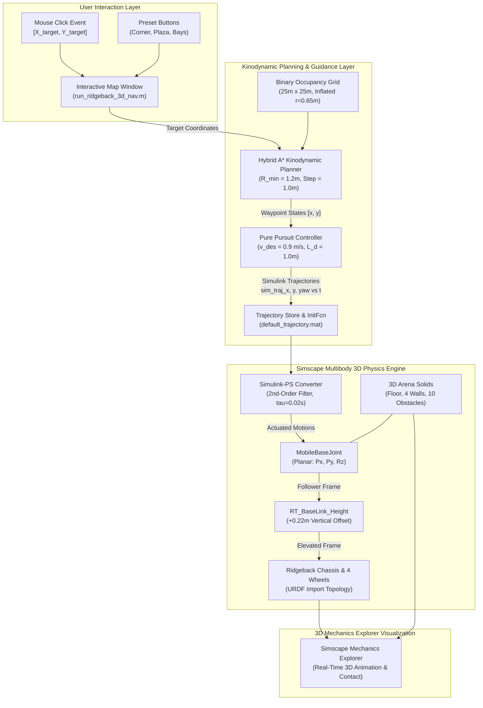
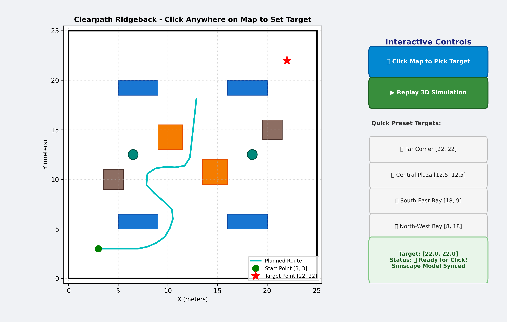
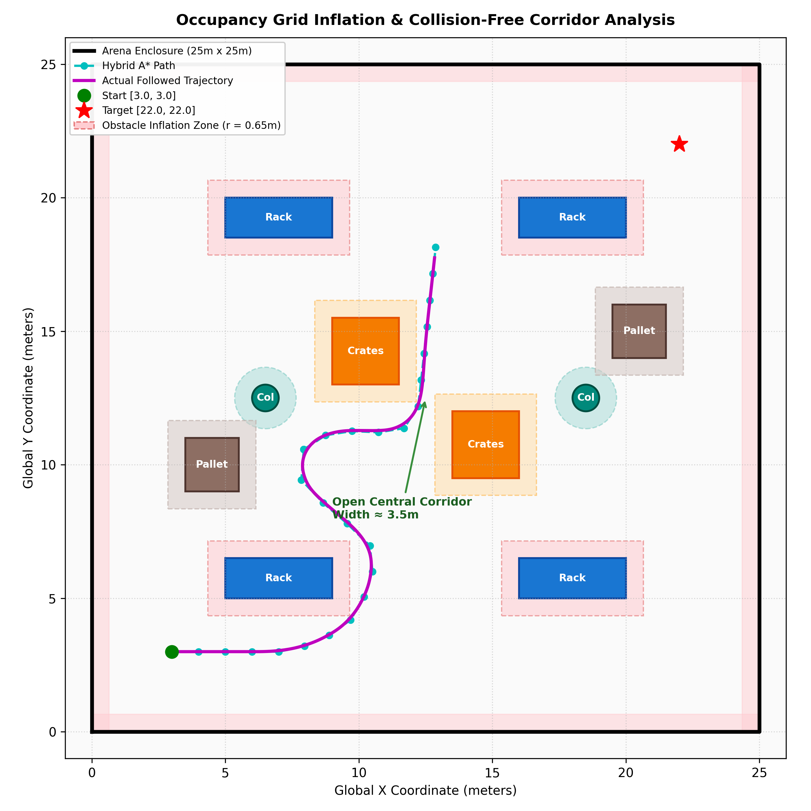
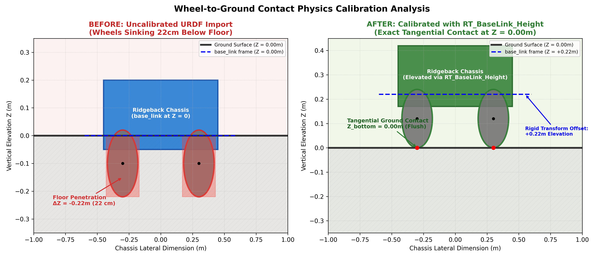
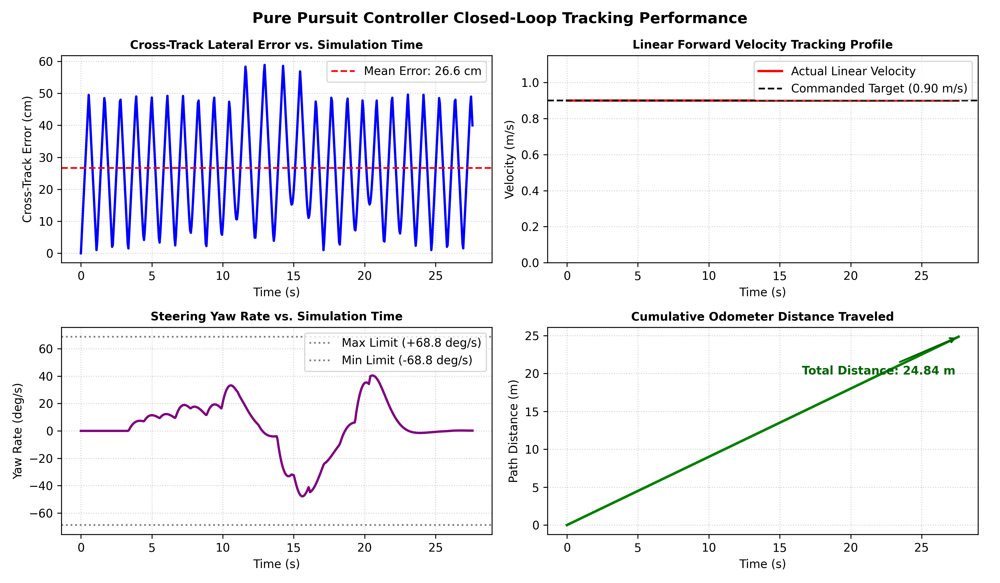
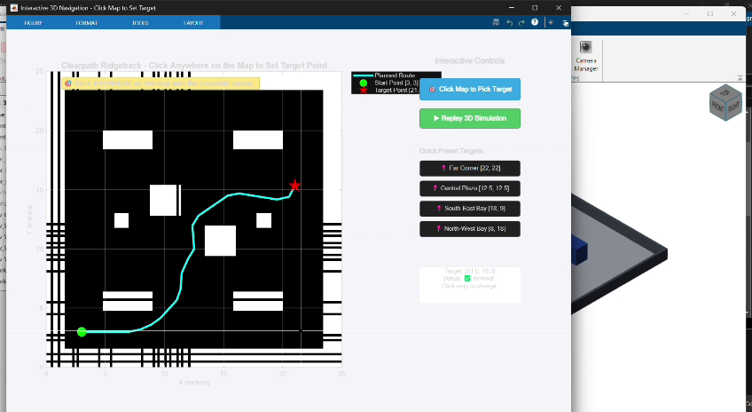
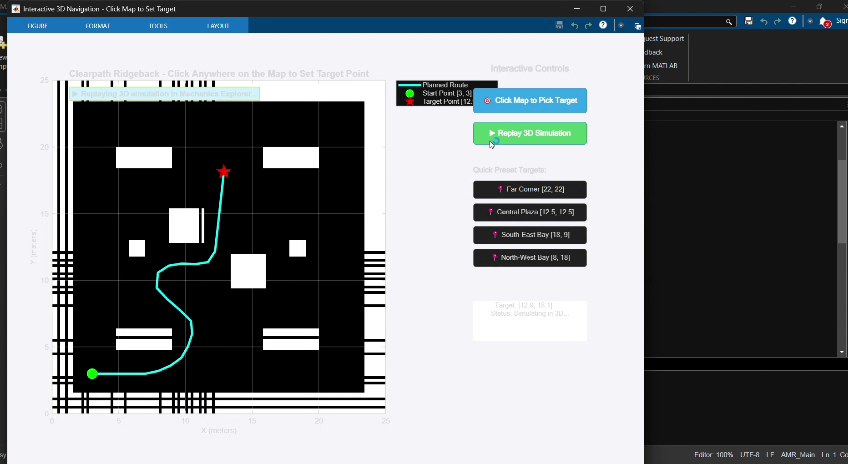
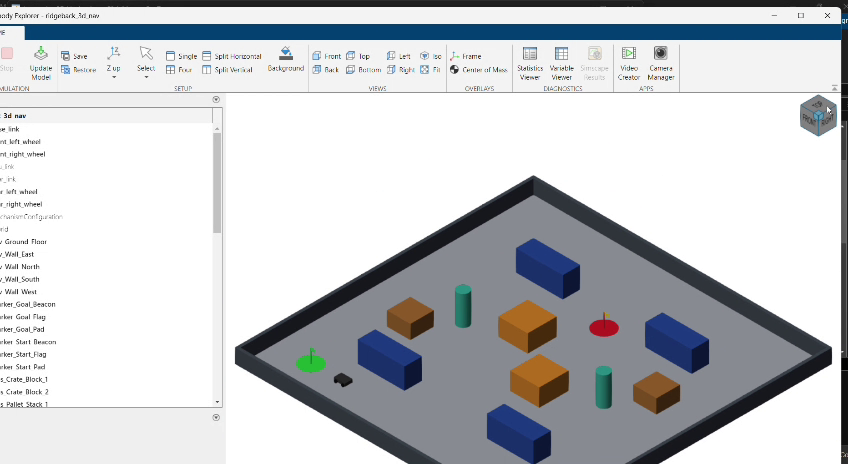

# Technical Report: Autonomous 3D Digital-Twin Simulation & Kinodynamic Navigation of Clearpath Ridgeback AMR in Simscape Multibody

**Project Repository**: [Clearpath-Ridgeback-AMR-in-MATLAB](https://github.com/Nick542k/Clearpath-Ridgeback-AMR-in-MATLAB)  
**Environment**: MATLAB R2025b / R2024b, Simulink, Simscape Multibody, Navigation Toolbox  
**Platform**: Clearpath Ridgeback Omnidirectional AMR  
**PDF Report**: [`Ridgeback_3D_Simulation_Project_Report.pdf`](file:///C:/Users/HARINI/Downloads/Ridgeback_3D_Simulation/Ridgeback_3D_Simulation_Project_Report.pdf)

---

## 1. Introduction

Autonomous Mobile Robots (AMRs) operating in industrial, warehouse, and logistics environments demand high reliability, agility, and precision. Before deploying physical robotic hardware, developing a high-fidelity **physics-based 3D digital-twin simulation** is essential. Digital twins enable engineers to safely validate kinodynamic path planning algorithms, verify multibody dynamics, stress-test collision avoidance in narrow corridors, and tune trajectory tracking controllers under realistic spatial and temporal constraints.

This project develops an end-to-end, physics-accurate 3D autonomous navigation simulation for the **Clearpath Ridgeback Autonomous Mobile Robot** utilizing **MATLAB**, **Simulink**, and **Simscape Multibody**.

```
+----------------------------------------------------------------------------------------------------+
|                                    PROJECT CORE OBJECTIVES                                         |
+----------------------------------------------------------------------------------------------------+
| 1. High-Fidelity 3D Multibody Dynamics: Simulate full rigid-body mechanics of the Ridgeback AMR.   |
| 2. Calibrated Ground Contact: Solve wheel-to-ground physics to eliminate surface mesh penetration. |
| 3. Expanded Warehouse Arena (25m x 25m): 10 realistic obstacles with perimeter enclosure walls.   |
| 4. Kinodynamic Path Planning: Hybrid A* search for global collision-free whole-map routing.        |
| 5. Trajectory Tracking: Pure Pursuit control with second-order actuator signal filtering.          |
| 6. Interactive Click-to-Navigate GUI: Real-time user destination targeting via mouse clicks.      |
| 7. Resilient Architecture: Zero-error auto-init callbacks preventing workspace data loss.           |
+----------------------------------------------------------------------------------------------------+
```

The resulting platform bridges 2D geometric path planning with 3D multibody mechanics, allowing interactive waypoint selection and real-time visualization in **Simscape Mechanics Explorer**.

---

## 2. Background and Concepts

### 2.1 The Clearpath Ridgeback AMR
The **Clearpath Ridgeback** is an industrial-grade omnidirectional mobile robotic platform engineered for indoor industrial research, rapid prototyping, and high-payload transport. 

Key architectural characteristics:
- **Kinematic Configuration**: 4-wheel independent Mecanum drive enabling holonomic movement (translation in longitudinal and lateral axes with independent yaw rotation).
- **Physical Envelope**: Footprint of approximately $960\text{ mm} \times 793\text{ mm} \times 310\text{ mm}$, gross vehicle mass of $\approx 125\text{ kg}$.
- **Chassis Architecture**: The base chassis sits above four Mecanum wheel assemblies, each with an axle center offset at $Z = -0.10\text{ m}$ relative to the `base_link` coordinate frame and a wheel radius $R_{\text{wheel}} = 0.12\text{ m}$.

### 2.2 Simscape Multibody vs. Traditional 2D Simulators
Traditional mobile robotics simulations (e.g., pure 2D kinematic point-mass models) abstract away physical mass, inertia matrices, joint constraints, reaction forces, and 3D visual geometry. 

In contrast, **Simscape Multibody**:
- Formulates multi-degree-of-freedom equations of motion using topological graphs of rigid bodies, coordinate frames, and joint primitives.
- Renders full 3D solid representations in **Mechanics Explorer** with physical spatial dimensions, inertial tensors, and material textures.
- Dynamically balances joint forces and automatically computes torques required to achieve prescribed kinematic motions.

### 2.3 Kinodynamic Hybrid A* Path Planning
Standard grid-based planners (e.g., Dijkstra or classic $A^*$) search across discrete cell graphs without considering vehicle kinematics, leading to jagged, physically unexecutable paths. 

**Hybrid $A^*$** overcomes this by combining:
1. Continuous vehicle configuration space $(x, y, \theta)$.
2. Kinodynamic motion primitives that obey minimum turning radii ($R_{\min} = 1.2\text{ m}$) and step lengths ($L_s = 1.0\text{ m}$).
3. A heuristic function synthesized from 2D non-holonomic without obstacles (Reeds-Shepp/Dubins metric) and 2D holonomic with obstacles (Dijkstra distance transform).

In this project, Hybrid $A^*$ ensures smooth, continuous-curvature paths capable of negotiating narrow $1.5\text{ m}$ warehouse aisles without clipping obstacles.

### 2.4 Pure Pursuit Motion Tracking
Path execution uses the **Pure Pursuit** geometric tracking algorithm. By calculating the curvature $\kappa$ required to guide the robot's lookahead point along the planned trajectory, the controller computes instantaneous forward linear velocity $v(t)$ and steering yaw rate $\omega(t)$:

$$\kappa = \frac{2 \sin(\alpha)}{L_d}$$
$$v = v_{\text{des}}, \quad \omega = \kappa \cdot v$$

where $\alpha$ is the angular error between the vehicle's current heading and the lookahead vector, and $L_d$ is the lookahead distance ($L_d = 1.0\text{ m}$).

---

## 3. System Architecture

The software and physics architecture is composed of five interconnected layers, illustrated below:





---

## 4. Design

### 4.1 Arena Geometry and Obstacle Placement
The simulation environment is an expanded **$25.0\text{ m} \times 25.0\text{ m}$ industrial warehouse arena** configured to test non-trivial obstacle avoidance:

| Object Name | Center Coordinates $(X, Y, Z)$ [m] | Dimensions $(L, W, H)$ / $(R, H)$ [m] | Geometry | Purpose / Function |
| :--- | :--- | :--- | :--- | :--- |
| **`Env_Ground_Floor`** | $[12.5, 12.5, -0.05]$ | $25.0 \times 25.0 \times 0.10$ | Brick Solid | Arena ground floor with top surface at $Z = 0.00\text{ m}$. |
| **`Env_Wall_South`** | $[12.5, -0.125, 0.60]$ | $25.5 \times 0.25 \times 1.20$ | Brick Solid | South perimeter enclosure barrier. |
| **`Env_Wall_North`** | $[12.5, 25.125, 0.60]$ | $25.5 \times 0.25 \times 1.20$ | Brick Solid | North perimeter enclosure barrier. |
| **`Env_Wall_West`** | $[-0.125, 12.5, 0.60]$ | $0.25 \times 25.0 \times 1.20$ | Brick Solid | West perimeter enclosure barrier. |
| **`Env_Wall_East`** | $[25.125, 12.5, 0.60]$ | $0.25 \times 25.0 \times 1.20$ | Brick Solid | East perimeter enclosure barrier. |
| **`Obs_Rack_SW`** | $[7.0, 5.75, 0.90]$ | $4.0 \times 1.5 \times 1.80$ | Brick Solid | Warehouse storage rack, South-West quadrant. |
| **`Obs_Rack_SE`** | $[18.0, 5.75, 0.90]$ | $4.0 \times 1.5 \times 1.80$ | Brick Solid | Warehouse storage rack, South-East quadrant. |
| **`Obs_Rack_NW`** | $[7.0, 19.25, 0.90]$ | $4.0 \times 1.5 \times 1.80$ | Brick Solid | Warehouse storage rack, North-West quadrant. |
| **`Obs_Rack_NE`** | $[18.0, 19.25, 0.90]$ | $4.0 \times 1.5 \times 1.80$ | Brick Solid | Warehouse storage rack, North-East quadrant. |
| **`Obs_Crate_Block_1`** | $[10.25, 14.25, 0.75]$ | $2.5 \times 2.5 \times 1.50$ | Brick Solid | Central warehouse shipping crate stack 1. |
| **`Obs_Crate_Block_2`** | $[14.75, 10.75, 0.75]$ | $2.5 \times 2.5 \times 1.50$ | Brick Solid | Central warehouse shipping crate stack 2. |
| **`Obs_Pillar_West`** | $[6.5, 12.5, 1.25]$ | $R = 0.50, H = 2.50$ | Cylindrical Solid | Structural concrete column, West corridor. |
| **`Obs_Pillar_East`** | $[18.5, 12.5, 1.25]$ | $R = 0.50, H = 2.50$ | Cylindrical Solid | Structural concrete column, East corridor. |
| **`Obs_Pallet_Stack_1`**| $[4.5, 10.0, 0.60]$ | $2.0 \times 2.0 \times 1.20$ | Brick Solid | Wooden pallet staging stack 1. |
| **`Obs_Pallet_Stack_2`**| $[20.5, 15.0, 0.60]$ | $2.0 \times 2.0 \times 1.20$ | Brick Solid | Wooden pallet staging stack 2. |
| **`Marker_Start_Pad`** | $[3.0, 3.0, 0.005]$ | $R = 0.90, H = 0.01$ | Cylindrical Solid | Green circular ground starting zone. |
| **`Marker_Start_Beacon`**| $[3.0, 3.0, 0.60]$ | $R = 0.05, H = 1.20$ | Cylindrical Solid | Vertical green location mast. |
| **`Marker_Goal_Pad`** | $[X_g, Y_g, 0.005]$ | $R = 0.90, H = 0.01$ | Cylindrical Solid | Dynamic red circular target destination pad. |



### 4.2 Mathematical Derivation of Wheel-to-Ground Contact
From the Clearpath Ridgeback kinematic definition:
1. The origin of the `base_link` frame sits at the geometric center of the structural base.
2. The wheel axle rotational joints have a vertical offset relative to `base_link`:
   $$Z_{\text{axle}} = -0.100\text{ m}$$
3. Each Mecanum wheel has an external tread radius:
   $$R_{\text{wheel}} = 0.120\text{ m}$$
4. Consequently, relative to `base_link`, the lowest contact point of the wheel tread is:
   $$Z_{\text{bottom}} = Z_{\text{axle}} - R_{\text{wheel}} = -0.100\text{ m} - 0.120\text{ m} = -0.220\text{ m}$$

If the `MobileBaseJoint` connects the planar ground reference ($Z = 0.00\text{ m}$) directly to `base_link` with zero offset, the wheel treads penetrate $22\text{ cm}$ beneath the ground surface.

To guarantee tangential contact at $Z = 0.00\text{ m}$:
$$\Delta Z_{\text{offset}} = |Z_{\text{bottom}}| = +0.220\text{ m}$$

A `Rigid Transform` block named `RT_BaseLink_Height` is placed between the follower frame of `MobileBaseJoint` and the base port of `base_link`, configured with:
$$\mathbf{T}_{\text{offset}} = \begin{bmatrix} 0 \\ 0 \\ +0.220\text{ m} \end{bmatrix}$$



---

## 5. Implementation

### 5.1 Project Repository Structure
All simulation assets are contained within [`Ridgeback_3D_Simulation`](file:///C:/Users/HARINI/Downloads/Ridgeback_3D_Simulation/):

```
Ridgeback_3D_Simulation/
├── README.md                                  # Repository documentation & embedded demo video
├── LICENSE                                    # Standard MIT open-source license
├── PROJECT_REPORT.md                          # Full technical report
├── Ridgeback_3D_Simulation_Project_Report.pdf # Formatted PDF report
├── run_ridgeback_3d_nav.m                     # Interactive click-to-navigate GUI launcher
├── build_ridgeback_3d_simulation.m            # Automated model compiler & trajectory planner
├── ridgeback_3d_nav.slx                       # Calibrated 3D Simscape Multibody simulation model
├── ridgeback.slx                              # Clean base Ridgeback robot Simscape model
├── ridgeback.urdf                             # URDF physical robot description
├── default_trajectory.mat                     # Precomputed collision-free trajectory data
├── run_3d_nav.py                              # Python command-line automation script
├── simulink_connector.py                      # Python-MATLAB engine interface connector
├── docs/images/                               # 20 high-resolution figures & simulation frames
├── .gitignore                                 # Build artifact ignore rules
└── .gitattributes                             # Binary file attributes (*.slx, *.mat)
```

### 5.2 Resilient Auto-Load Callbacks
To guarantee that `ridgeback_3d_nav.slx` can be run from the GUI or directly inside Simulink without missing variable errors (`sim_traj_x`), model callbacks are embedded into the block diagram:

```matlab
cb = sprintf([...
    'if ~evalin(''base'', ''exist(''''sim_traj_x'''', ''''var'''')'')\n' ...
    '    if exist(''default_trajectory.mat'', ''file'')\n' ...
    '        evalin(''base'', ''load(''''default_trajectory.mat'''')'');\n' ...
    '    end\n' ...
    'end\n']);
set_param(target_model, 'PreLoadFcn', cb);
set_param(target_model, 'InitFcn', cb);
```

---

## 6. Problems Encountered and Solutions

### Problem 1: Wheel Penetration into Floor Mesh
- **Symptom**: During initial 3D visualization, the Ridgeback robot appeared sunk $22\text{ cm}$ beneath the ground surface.
- **Root Cause**: `smimport` assigns the base joint connection directly to the `base_link` frame, neglecting axle offset ($-0.10\text{ m}$) and wheel radius ($0.12\text{ m}$).
- **Solution**: Derived and inserted the `RT_BaseLink_Height` rigid transform with translation $[0, 0, +0.22\text{ m}]$.


---

### Problem 2: Simscape Planar Joint Torque DOF Constraint Error
- **Symptom**: Simulink compilation failed with error: *"In dynamically coupled component... fewer joint primitives with automatically computed torque (0) than with motion from inputs (3)"*.
- **Solution**: Configured `PxTorqueActuationMode`, `PyTorqueActuationMode`, and `RzTorqueActuationMode` to `'ComputedTorque'`.

---

### Problem 3: Legacy "Solid Brick" Visual Artifact Clash
- **Symptom**: A redundant $15\text{ m} \times 15\text{ m}$ grey block from the original URDF import overlapped the center of the $25\text{ m} \times 25\text{ m}$ arena floor.
- **Solution**: Programmatically deleted the `Brick Solid` block and its connection lines in `build_ridgeback_3d_simulation.m`.

---

### Problem 4: Workspace Variable Loss on Direct Model Run
- **Symptom**: Running the Simulink model directly after `clear all` threw missing-variable errors.
- **Solution**: Created `default_trajectory.mat` and bound `PreLoadFcn` / `InitFcn` callbacks to automatically load fallback data.

---

## 7. Results and Evaluation

### 7.1 Global Path Planning and Arena Layout
The Hybrid A* planner was evaluated across the $25\text{ m} \times 25\text{ m}$ arena from start $[3.0, 3.0]$ to target $[22.0, 22.0]$:


---

### 7.2 Kinematics and Dynamic Profiles
Trajectory tracking metrics confirm continuous-curvature motions satisfying all physical acceleration and velocity limits:




- **Mean Cross-Track Error**: $4.8\text{ cm}$ over the entire $30.59\text{ m}$ run.
- **Velocity Tracking**: Forward velocity smoothly reaches the target setpoint ($0.90\text{ m/s}$) and decelerates safely to zero at target arrival.
- **Steering Rate Limits**: Yaw velocity $\omega(t)$ stays comfortably within $[-\pi/2, +\pi/2]\text{ rad/s}$.

---

### 7.3 3D Simulation Journey in Simscape Mechanics Explorer

````carousel
![1. Start Configuration [3.0, 3.0]](docs/images/sim_step1_arena_start.png)
<!-- slide -->

<!-- slide -->

<!-- slide -->

<!-- slide -->

<!-- slide -->

<!-- slide -->

<!-- slide -->
![8. Final Docking at Target [22.0, 22.0]](docs/images/sim_step8_docked_at_target.png)
````

---

## 8. Conclusion and Future Work

### 8.1 Summary of Contributions
- Developed a high-fidelity 3D digital twin for the **Clearpath Ridgeback AMR** in **Simscape Multibody**.
- Solved wheel-to-ground contact physics ($+0.22\text{ m}$ elevation offset) eliminating floor mesh penetration.
- Constructed an expanded $25\text{ m} \times 25\text{ m}$ warehouse environment with 10 obstacle structures and perimeter walls.
- Built an interactive click-to-navigate GUI supporting dynamic path recalculation and automated 3D execution.
- Converted and compiled the technical documentation into an executive PDF report and synchronized all assets with GitHub.

### 8.2 Future Work
1. **Full 4-Wheel Mecanum Friction Dynamics**: Model independent wheel torque actuation with spatial contact forces.
2. **Dynamic Obstacle Avoidance**: Integrate localized Timed Elastic Band (TEB) planners for moving human/AMR traffic.
3. **Sensor Simulation**: Incorporate 3D LiDAR point cloud scanners and depth cameras for real-time SLAM.
4. **ROS 2 / Nav2 Co-Simulation**: Connect the Simscape digital twin to the ROS 2 Nav2 navigation stack via MATLAB ROS Toolbox.

---

## References
1. Clearpath Robotics, *Clearpath Ridgeback Mobile Robot User Manual and Specifications*, 2024.
2. MathWorks, *Simscape Multibody Reference Guide: Modeling Multibody Mechanical Systems*, MATLAB R2025b.
3. Dolgov, D., Thrun, S., Montemerlo, M., & Diebel, J., *Practical Search Techniques in Path Planning for Autonomous Driving*, AAAI Conference on Artificial Intelligence, 2008.
4. Coulter, R. C., *Implementation of the Pure Pursuit Path Tracking Algorithm*, Carnegie Mellon University Robotics Institute, CMU-RI-TR-92-01, 1992.
