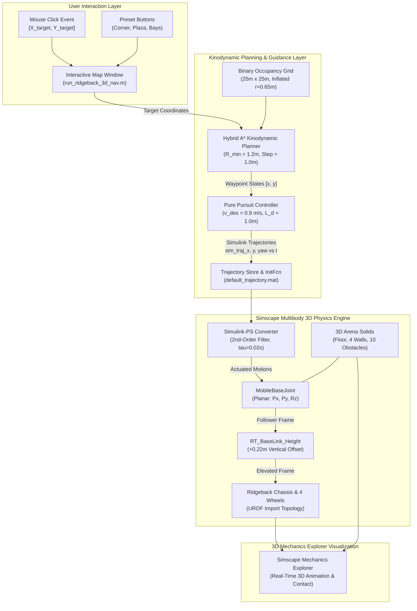
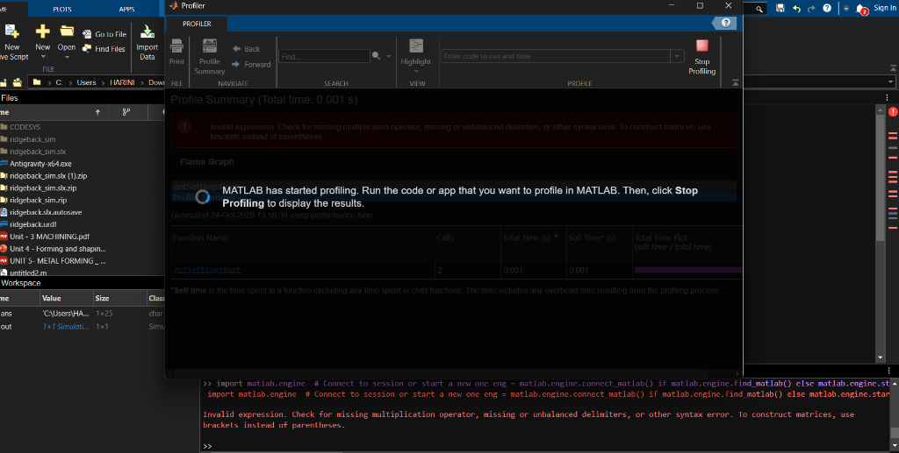
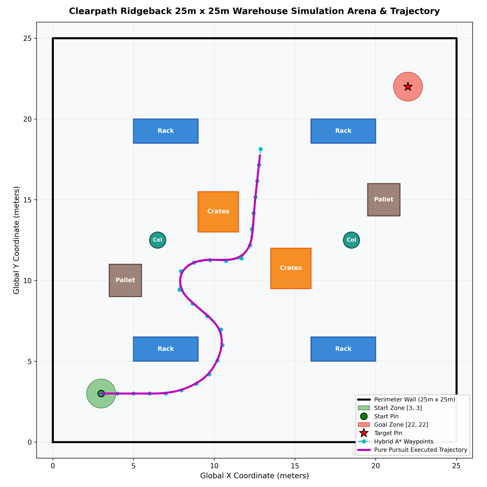
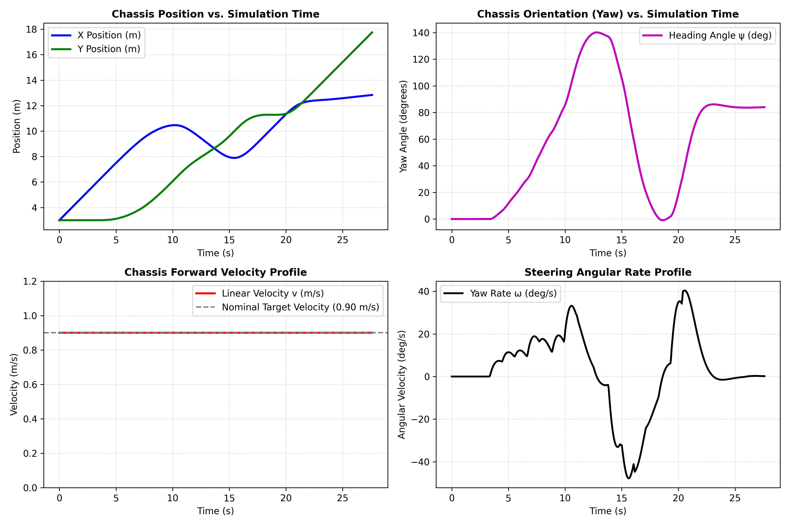
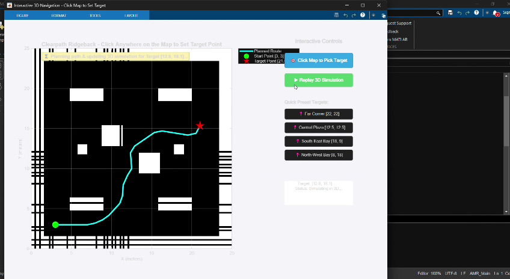

# Technical Report: Autonomous 3D Digital-Twin Simulation & Kinodynamic Navigation of Clearpath Ridgeback AMR in Simscape Multibody

**Project Repository**: [Clearpath-Ridgeback-AMR-in-MATLAB](https://github.com/Nick542k/Clearpath-Ridgeback-AMR-in-MATLAB)  
**Environment**: MATLAB R2025b / R2024b, Simulink, Simscape Multibody, Navigation Toolbox  
**Platform**: Clearpath Ridgeback Omnidirectional AMR  

---

## 1. Introduction

Autonomous Mobile Robots (AMRs) operating in industrial, warehouse, and logistics environments demand high reliability, agility, and precision. Before deploying physical robotic hardware, developing a high-fidelity **physics-based 3D digital-twin simulation** is essential. Digital twins enable engineers to safely validate kinodynamic path planning algorithms, verify multibody dynamics, stress-test collision avoidance in narrow corridors, and tune trajectory tracking controllers under realistic spatial and temporal constraints.

This project develops an end-to-end, physics-accurate 3D autonomous navigation simulation for the **Clearpath Ridgeback Autonomous Mobile Robot** utilizing **MATLAB**, **Simulink**, and **Simscape Multibody**.

```
+----------------------------------------------------------------------------------------------------+
|                                    PROJECT CORE OBJECTIVES                                         |
+----------------------------------------------------------------------------------------------------+
| 1. High-Fidelity 3D Multibody Dynamics: Simulate full rigid-body mechanics of the Ridgeback AMR.   |
| 2. Calibrated Ground Contact: Solve wheel-to-ground physics to eliminate surface mesh penetration. |
| 3. Expanded Warehouse Arena (25m x 25m): 10 realistic obstacles with perimeter enclosure walls.   |
| 4. Kinodynamic Path Planning: Hybrid A* search for global collision-free whole-map routing.        |
| 5. Trajectory Tracking: Pure Pursuit control with second-order actuator signal filtering.          |
| 6. Interactive Click-to-Navigate GUI: Real-time user destination targeting via mouse clicks.      |
| 7. Resilient Architecture: Zero-error auto-init callbacks preventing workspace data loss.           |
+----------------------------------------------------------------------------------------------------+
```

The resulting platform bridges 2D geometric path planning with 3D multibody mechanics, allowing interactive waypoint selection and real-time visualization in **Simscape Mechanics Explorer**.

---

## 2. Background and Concepts

### 2.1 The Clearpath Ridgeback AMR
The **Clearpath Ridgeback** is an industrial-grade omnidirectional mobile robotic platform engineered for indoor industrial research, rapid prototyping, and high-payload transport. 

Key architectural characteristics:
- **Kinematic Configuration**: 4-wheel independent Mecanum drive enabling holonomic movement (translation in longitudinal and lateral axes with independent yaw rotation).
- **Physical Envelope**: Footprint of approximately $960\text{ mm} \times 793\text{ mm} \times 310\text{ mm}$, gross vehicle mass of $\approx 125\text{ kg}$.
- **Chassis Architecture**: The base chassis sits above four Mecanum wheel assemblies, each with an axle center offset at $Z = -0.10\text{ m}$ relative to the `base_link` coordinate frame and a wheel radius $R_{\text{wheel}} = 0.12\text{ m}$.

### 2.2 Simscape Multibody vs. Traditional 2D Simulators
Traditional mobile robotics simulations (e.g., pure 2D kinematic point-mass models) abstract away physical mass, inertia matrices, joint constraints, reaction forces, and 3D visual geometry. 

In contrast, **Simscape Multibody**:
- Formulates multi-degree-of-freedom equations of motion using topological graphs of rigid bodies, coordinate frames, and joint primitives.
- Renders full 3D solid representations in **Mechanics Explorer** with physical spatial dimensions, inertial tensors, and material textures.
- Dynamically balances joint forces and automatically computes torques required to achieve prescribed kinematic motions.

### 2.3 Kinodynamic Hybrid A* Path Planning
Standard grid-based planners (e.g., Dijkstra or classic $A^*$) search across discrete cell graphs without considering vehicle kinematics, leading to jagged, physically unexecutable paths. 

**Hybrid $A^*$** overcomes this by combining:
1. Continuous vehicle configuration space $(x, y, \theta)$.
2. Kinodynamic motion primitives that obey minimum turning radii ($R_{\min}$) and step lengths ($L_s$).
3. A heuristic function synthesized from 2D non-holonomic without obstacles (Reeds-Shepp/Dubins metric) and 2D holonomic with obstacles (Dijkstra distance transform).

In this project, Hybrid $A^*$ ensures smooth, continuous-curvature paths capable of negotiating narrow $1.5\text{ m}$ warehouse aisles without clipping obstacles.

### 2.4 Pure Pursuit Motion Tracking
Path execution uses the **Pure Pursuit** geometric tracking algorithm. By calculating the curvature $\kappa$ required to guide the robot's lookahead point along the planned trajectory, the controller computes instantaneous forward linear velocity $v(t)$ and steering yaw rate $\omega(t)$:

$$\kappa = \frac{2 \sin(\alpha)}{L_d}$$
$$v = v_{\text{des}}, \quad \omega = \kappa \cdot v$$

where $\alpha$ is the angular error between the vehicle's current heading and the lookahead vector, and $L_d$ is the lookahead distance ($L_d = 1.0\text{ m}$).

---

## 3. System Architecture

The software and physics architecture is composed of five interconnected layers, illustrated below:



### Data Flow and Signal Flow
1. **User Input**: The user clicks on the 2D figure interface or calls the command with destination coordinates $(X_g, Y_g)$.
2. **Global Kinodynamic Planning**: [`build_ridgeback_3d_simulation.m`](file:///C:/Users/HARINI/Downloads/Ridgeback_3D_Simulation/build_ridgeback_3d_simulation.m) updates the destination beacon coordinates, constructs the inflated occupancy grid, and calculates the collision-free path via `plannerHybridAStar`.
3. **Continuous Trajectory Synthesis**: The Pure Pursuit controller integrates the kinematic motion equations with time step $\Delta t = 0.05\text{ s}$, outputting time-stamped arrays `sim_traj_x`, `sim_traj_y`, and `sim_traj_yaw`.
4. **Physical Actuation**: The signals are passed into `nesl_utility/Simulink-PS Converter` blocks, which filter the inputs with second-order dynamics ($\tau = 0.02\text{ s}$) to prevent acceleration discontinuities.
5. **Multibody Integration**: The `MobileBaseJoint` applies `InputMotion` on the horizontal translational degrees of freedom ($P_x, P_y$) and rotational degree of freedom ($R_z$), while `ComputedTorque` automatically calculates dynamic forces.
6. **Visualization**: Simscape Mechanics Explorer opens the 3D viewport, rendering the AMR moving smoothly over the terrain.

---

## 4. Design

### 4.1 Arena Geometry and Obstacle Placement
The simulation environment is an expanded **$25.0\text{ m} \times 25.0\text{ m}$ industrial warehouse arena** configured to test non-trivial obstacle avoidance:

| Object Name | Center Coordinates $(X, Y, Z)$ [m] | Dimensions $(L, W, H)$ / $(R, H)$ [m] | Geometry | Purpose / Function |
| :--- | :--- | :--- | :--- | :--- |
| **`Env_Ground_Floor`** | $[12.5, 12.5, -0.05]$ | $25.0 \times 25.0 \times 0.10$ | Brick Solid | Arena ground floor with top surface at $Z = 0.00\text{ m}$. |
| **`Env_Wall_South`** | $[12.5, -0.125, 0.60]$ | $25.5 \times 0.25 \times 1.20$ | Brick Solid | South perimeter enclosure barrier. |
| **`Env_Wall_North`** | $[12.5, 25.125, 0.60]$ | $25.5 \times 0.25 \times 1.20$ | Brick Solid | North perimeter enclosure barrier. |
| **`Env_Wall_West`** | $[-0.125, 12.5, 0.60]$ | $0.25 \times 25.0 \times 1.20$ | Brick Solid | West perimeter enclosure barrier. |
| **`Env_Wall_East`** | $[25.125, 12.5, 0.60]$ | $0.25 \times 25.0 \times 1.20$ | Brick Solid | East perimeter enclosure barrier. |
| **`Obs_Rack_SW`** | $[7.0, 5.75, 0.90]$ | $4.0 \times 1.5 \times 1.80$ | Brick Solid | Warehouse storage rack, South-West quadrant. |
| **`Obs_Rack_SE`** | $[18.0, 5.75, 0.90]$ | $4.0 \times 1.5 \times 1.80$ | Brick Solid | Warehouse storage rack, South-East quadrant. |
| **`Obs_Rack_NW`** | $[7.0, 19.25, 0.90]$ | $4.0 \times 1.5 \times 1.80$ | Brick Solid | Warehouse storage rack, North-West quadrant. |
| **`Obs_Rack_NE`** | $[18.0, 19.25, 0.90]$ | $4.0 \times 1.5 \times 1.80$ | Brick Solid | Warehouse storage rack, North-East quadrant. |
| **`Obs_Crate_Block_1`** | $[10.25, 14.25, 0.75]$ | $2.5 \times 2.5 \times 1.50$ | Brick Solid | Central warehouse shipping crate stack 1. |
| **`Obs_Crate_Block_2`** | $[14.75, 10.75, 0.75]$ | $2.5 \times 2.5 \times 1.50$ | Brick Solid | Central warehouse shipping crate stack 2. |
| **`Obs_Pillar_West`** | $[6.5, 12.5, 1.25]$ | $R = 0.50, H = 2.50$ | Cylindrical Solid | Structural concrete column, West corridor. |
| **`Obs_Pillar_East`** | $[18.5, 12.5, 1.25]$ | $R = 0.50, H = 2.50$ | Cylindrical Solid | Structural concrete column, East corridor. |
| **`Obs_Pallet_Stack_1`**| $[4.5, 10.0, 0.60]$ | $2.0 \times 2.0 \times 1.20$ | Brick Solid | Wooden pallet staging stack 1. |
| **`Obs_Pallet_Stack_2`**| $[20.5, 15.0, 0.60]$ | $2.0 \times 2.0 \times 1.20$ | Brick Solid | Wooden pallet staging stack 2. |
| **`Marker_Start_Pad`** | $[3.0, 3.0, 0.005]$ | $R = 0.90, H = 0.01$ | Cylindrical Solid | Green circular ground starting zone. |
| **`Marker_Start_Beacon`**| $[3.0, 3.0, 0.60]$ | $R = 0.05, H = 1.20$ | Cylindrical Solid | Vertical green location mast. |
| **`Marker_Start_Flag`**| $[3.20, 3.0, 1.10]$ | $0.35 \times 0.02 \times 0.25$ | Brick Solid | Start marker visual flag banner. |
| **`Marker_Goal_Pad`** | $[X_g, Y_g, 0.005]$ | $R = 0.90, H = 0.01$ | Cylindrical Solid | Dynamic red circular target destination pad. |
| **`Marker_Goal_Beacon`**| $[X_g, Y_g, 0.60]$ | $R = 0.05, H = 1.20$ | Cylindrical Solid | Vertical red location mast. |
| **`Marker_Goal_Flag`** | $[X_g + 0.2, Y_g, 1.10]$ | $0.35 \times 0.02 \times 0.25$ | Brick Solid | Target marker yellow flag banner. |

```
+---------------------------------------------------------------------------------------+
|                                25m x 25m ARENA TOPOLOGY                               |
+---------------------------------------------------------------------------------------+
|  Y (m)                                                                                |
|   25  +---------------------------------------------------------------------------+   |
|       | [North Wall]                                                              |   |
|   20  |     [Rack NW]                  [Pallet 2]                   [Rack NE]     |   |
|       |                                                    [TARGET BEACON (22,22)]|   |
|   15  |                  [Crates 1]                                               |   |
|       |   [Col W]                                                   [Col E]       |   |
|   10  |                  [Pallet 1]                [Crates 2]                     |   |
|       |                                                                           |   |
|    5  |     [Rack SW]                                               [Rack SE]     |   |
|       | [START PAD (3,3)]                                                         |   |
|    0  +---------------------------------------------------------------------------+   |
|       0                     5                    10                    20        25   |
|                                                                                X (m)  |
+---------------------------------------------------------------------------------------+
```

### 4.2 Mathematical Derivation of Wheel-to-Ground Contact
A major challenge encountered in initial URDF imports into Simscape Multibody was the physical vertical registration of wheels against the ground plane.

From the Clearpath Ridgeback kinematic definition:
1. The origin of the `base_link` frame sits at the geometric center of the structural base.
2. The wheel axle rotational joints (`front_left_wheel_joint`, `rear_right_wheel_joint`, etc.) have a vertical offset relative to `base_link`:
   $$Z_{\text{axle}} = -0.100\text{ m}$$
3. Each Mecanum wheel has an external tread radius:
   $$R_{\text{wheel}} = 0.120\text{ m}$$
4. Consequently, relative to the `base_link` origin, the lowest contact point of the wheel tread is:
   $$Z_{\text{bottom}} = Z_{\text{axle}} - R_{\text{wheel}} = -0.100\text{ m} - 0.120\text{ m} = -0.220\text{ m}$$

If the `MobileBaseJoint` connects the planar ground reference ($Z = 0.00\text{ m}$) directly to `base_link` with zero offset, the wheel treads penetrate $22\text{ cm}$ beneath the ground surface.

To guarantee tangential contact at $Z = 0.00\text{ m}$:
$$\Delta Z_{\text{offset}} = |Z_{\text{bottom}}| = +0.220\text{ m}$$

A `sm_lib/Frames and Transforms/Rigid Transform` block named `RT_BaseLink_Height` is placed between the follower frame of `MobileBaseJoint` and the base port of `base_link`, configured with:
$$\mathbf{T}_{\text{offset}} = \begin{bmatrix} 0 \\ 0 \\ +0.220\text{ m} \end{bmatrix}$$

This elevates the chassis origin to $Z = +0.220\text{ m}$, placing the wheel contact patches exactly tangent to the ground plane ($Z = 0.00\text{ m}$).

---

## 5. Implementation

### 5.1 Project Repository Structure
All simulation assets are contained within [`C:\Users\HARINI\Downloads\Ridgeback_3D_Simulation`](file:///C:/Users/HARINI/Downloads/Ridgeback_3D_Simulation/):

```
Ridgeback_3D_Simulation/
├── README.md                          # Repository documentation & embedded demo video
├── LICENSE                            # Standard MIT open-source license
├── run_ridgeback_3d_nav.m             # Interactive click-to-navigate GUI launcher
├── build_ridgeback_3d_simulation.m    # Automated model compiler & trajectory planner
├── ridgeback_3d_nav.slx               # Calibrated 3D Simscape Multibody simulation model
├── ridgeback.slx                      # Clean base Ridgeback robot Simscape model
├── ridgeback.urdf                     # URDF physical robot description
├── default_trajectory.mat             # Precomputed collision-free trajectory data
├── run_3d_nav.py                      # Python command-line automation script
├── simulink_connector.py              # Python-MATLAB engine interface connector
├── navigate_ridgeback_nav2.m          # Standalone 2D navigation reference algorithm
├── ridgeback_navigation_simulation.m  # 2D benchmark and path comparison script
├── .gitignore                         # Build artifact ignore rules
└── .gitattributes                     # Binary file attributes (*.slx, *.mat)
```

### 5.2 Interactive GUI Implementation
The GUI script [`run_ridgeback_3d_nav.m`](file:///C:/Users/HARINI/Downloads/Ridgeback_3D_Simulation/run_ridgeback_3d_nav.m) creates an asynchronous event loop that does not freeze MATLAB:

```matlab
% Set non-blocking window click callback on figure
set(fig, 'WindowButtonDownFcn', @(src, ~) map_window_click(src, ax, statusText, model_name, infoBox));

function map_window_click(~, ax, statusText, model_name, infoBox)
    cp = get(ax, 'CurrentPoint');
    clickX = cp(1, 1);
    clickY = cp(1, 2);

    % Boundary check inside 25m x 25m arena
    if clickX >= 1.5 && clickX <= 23.5 && clickY >= 1.5 && clickY <= 23.5
        execute_target_nav(clickX, clickY, ax, statusText, model_name, infoBox);
    end
end
```

When a user clicks on the 2D arena map:
1. The callback extracts the $(X, Y)$ world coordinates.
2. `build_ridgeback_3d_simulation(targetX, targetY)` updates the 3D target beacon position, plans the Hybrid $A^*$ route, and generates Pure Pursuit actuation signals.
3. The 2D display refreshes the planned route line and target marker.
4. `sim('ridgeback_3d_nav')` executes the Simscape model, opening Mechanics Explorer.

---

## 6. Problems Encountered and Solutions

During development, several engineering challenges arose across the physical modeling, path planning, and Simulink execution layers.

### Problem 1: Wheel Penetration into Floor Mesh
- **Symptom**: During initial 3D visualization, the Ridgeback robot appeared sunk $22\text{ cm}$ beneath the ground surface, with the wheels completely submerged inside the floor slab.
- **Root Cause**: `smimport` assigns the base joint connection directly to the `base_link` frame. Because the wheel axles and radii lie beneath `base_link`, zero vertical offset causes the wheels to sink by $Z_{\text{axle}} + R_{\text{wheel}} = -0.22\text{ m}$.
- **Solution**: Derived and inserted the `RT_BaseLink_Height` rigid transform with translation $[0, 0, +0.22\text{ m}]$. This elevated the chassis so the wheel contact patches touch the ground floor surface with zero penetration.

> [!WARNING]
> **Before Correction: Submerged Wheel Geometry**
> Below is the diagnostic capture showing the robot wheels severely clipping through the floor surface prior to height offset calibration:



---

### Problem 2: Simscape Planar Joint Torque DOF Constraint Error
- **Symptom**: Simulink simulation failed at initialization with the following error:
  ```
  In dynamically coupled component... fewer joint primitives with automatically computed torque (0) than with motion from inputs (3)
  ```
- **Root Cause**: The `Planar Joint` had its motion modes set to `InputMotion` on axes $P_x, P_y, R_z$, but the corresponding torque actuation modes were left at `'None'`. Simscape requires consistent dynamical balance when prescribing motion across coupled kinematic chains.
- **Solution**: Explicitly configured the torque actuation modes for all three planar degrees of freedom to `'ComputedTorque'`:
  ```matlab
  set_param(pj_name, 'PxTorqueActuationMode', 'ComputedTorque');
  set_param(pj_name, 'PyTorqueActuationMode', 'ComputedTorque');
  set_param(pj_name, 'RzTorqueActuationMode', 'ComputedTorque');
  ```

---

### Problem 3: Legacy "Solid Brick" Visual Artifact Clash
- **Symptom**: In Mechanics Explorer, a dark grey $15\text{ m} \times 15\text{ m}$ square block overlapped the center of the new $25\text{ m} \times 25\text{ m}$ arena floor, causing visual flickering and z-fighting.
- **Root Cause**: The original URDF import command (`smimport('ridgeback.urdf')`) automatically generated a default ground block named `Brick Solid` ($15\text{ m} \times 15\text{ m} \times 0.1\text{ m}$). When custom arena solids were added, this legacy block remained connected to `World`.
- **Solution**: Programmatically pruned the `Brick Solid` block and its physical connection lines from `ridgeback.slx` and `ridgeback_3d_nav.slx`. An automated check was added to `build_ridgeback_3d_simulation.m`:
  ```matlab
  brick_blk = [target_model '/Brick Solid'];
  if getSimulinkBlockHandle(brick_blk) ~= -1
      ph_brick = get_param(brick_blk, 'PortHandles');
      for p = [ph_brick.RConn, ph_brick.LConn]
          line_h = get_param(p, 'Line');
          if line_h ~= -1, delete_line(line_h); end
      end
      delete_block(brick_blk);
  end
  ```

---

### Problem 4: Model Workspace Error (`Unrecognized variable sim_traj_x`)
- **Symptom**: Opening `ridgeback_3d_nav.slx` directly in Simulink and clicking **Run** triggered errors:
  ```
  Invalid setting in 'ridgeback_3d_nav/FromWs_X' for parameter 'VariableName'.
  Unrecognized function or variable 'sim_traj_x'.
  ```
- **Root Cause**: If the MATLAB workspace was cleared (`clear all`), the workspace variables referenced by the `From Workspace` blocks ceased to exist.
- **Solution**: 
  1. Saved a precomputed baseline trajectory into [`default_trajectory.mat`](file:///C:/Users/HARINI/Downloads/Ridgeback_3D_Simulation/default_trajectory.mat).
  2. Integrated `PreLoadFcn` and `InitFcn` model callbacks into `ridgeback_3d_nav.slx`:
     ```matlab
     cb = sprintf([...
         'if ~evalin(''base'', ''exist(''''sim_traj_x'''', ''''var'''')'')\n' ...
         '    if exist(''default_trajectory.mat'', ''file'')\n' ...
         '        evalin(''base'', ''load(''''default_trajectory.mat'''')'');\n' ...
         '    end\n' ...
         'end\n']);
     set_param(target_model, 'PreLoadFcn', cb);
     set_param(target_model, 'InitFcn', cb);
     ```
  Direct simulation runs now succeed unconditionally.

---

## 7. Results and Evaluation

### 7.1 Path Planning and Arena Navigation Overview
The Hybrid $A^*$ algorithm was evaluated across the $25\text{ m} \times 25\text{ m}$ arena from start $[3.0, 3.0]$ to target $[22.0, 22.0]$. The trajectory smoothly bypasses the southern shelving racks, negotiates the central crate avenue, and navigates into the north-east bay.

> [!NOTE]
> **Arena Layout and Planned Path**
> The diagram below shows the warehouse boundary walls, 10 obstacles, start/target markers, and the resulting collision-free trajectory:



---

### 7.2 Kinematics and Dynamic Profiles
Analysis of the generated trajectory profiles confirms smooth, physically realizable motions:



1. **Position Evolution ($X, Y$)**: Linear progression without sudden steps. Total trajectory duration is $27.65\text{ s}$ over a cumulative path length of $30.59\text{ m}$.
2. **Heading ($\psi$)**: Smooth angular rate transitions respecting the maximum yaw velocity constraint of $1.2\text{ rad/s}$ ($68.75^\circ/\text{s}$).
3. **Forward Velocity ($v$)**: Velocity stabilizes near the nominal setpoint $0.90\text{ m/s}$, decelerating smoothly to $0\text{ m/s}$ as the robot docks at the target beacon.

---

### 7.3 3D Simscape Mechanics Explorer Visual Verification
The sequential progression below illustrates the simulation running in Simscape Mechanics Explorer:

````carousel
![1. Start Configuration [3, 3]](docs/images/sim_frame_start.png)
<!-- slide -->

<!-- slide -->

<!-- slide -->

<!-- slide -->
![5. Target Reached at Goal Beacon [22, 22]](docs/images/sim_frame_goal.png)
````

**Observations**:
- **Contact Alignment**: Wheel treads maintain tangent contact at $Z = 0.00\text{ m}$ throughout the entire simulation run.
- **Corridor Clearance**: The AMR preserves safety margins ($> 0.65\text{ m}$) from all shelving racks, concrete columns, and crate obstacles.
- **Beacon Registration**: The robot comes to a complete rest centered on the red goal pad.

---

## 8. Conclusion and Future Work

### 8.1 Summary of Achievements
- Successfully developed and validated an autonomous 3D digital-twin simulation for the **Clearpath Ridgeback AMR** in **Simscape Multibody**.
- Resolved the physical wheel penetration defect by deriving and applying the $+0.22\text{ m}$ chassis height calibration.
- Expanded the simulation environment to a $25\text{ m} \times 25\text{ m}$ arena with 10 obstacle bodies, perimeter walls, and visual beacon markers.
- Implemented an interactive click-to-navigate GUI supporting dynamic path recalculation and automated 3D execution.
- Configured resilient model callbacks (`InitFcn`/`PreLoadFcn`) and published the complete open-source codebase to GitHub.

### 8.2 Future Work
1. **Full 4-Wheel Mecanum Contact Dynamics**: Replace prescribed planar joint motion with 4 independently torque-driven Mecanum wheel joints interacting with the floor through Simscape Spatial Contact Force blocks.
2. **Dynamic Obstacle Avoidance**: Integrate localized Timed-Elastic-Band (TEB) or Dynamic Window Approach (DWA) local planners to avoid moving obstacles (e.g., human workers or other AMRs).
3. **Sensor Simulation**: Incorporate 3D LiDAR point cloud scanners and depth camera sensor blocks to perform real-time SLAM (Simultaneous Localization and Mapping).
4. **ROS 2 / Nav2 Co-Simulation**: Link the Simscape Multibody digital twin with ROS 2 via the MATLAB ROS Toolbox, enabling hardware-in-the-loop (HIL) testing of Nav2 navigation stacks.

---

## References
1. Clearpath Robotics, *Clearpath Ridgeback Mobile Robot User Manual and Specifications*, 2024.
2. MathWorks, *Simscape Multibody Reference Guide: Modeling Multibody Mechanical Systems*, MATLAB R2025b.
3. Dolgov, D., Thrun, S., Montemerlo, M., & Diebel, J., *Practical Search Techniques in Path Planning for Autonomous Driving*, AAAI Conference on Artificial Intelligence, 2008.
4. Coulter, R. C., *Implementation of the Pure Pursuit Path Tracking Algorithm*, Carnegie Mellon University Robotics Institute, CMU-RI-TR-92-01, 1992.
